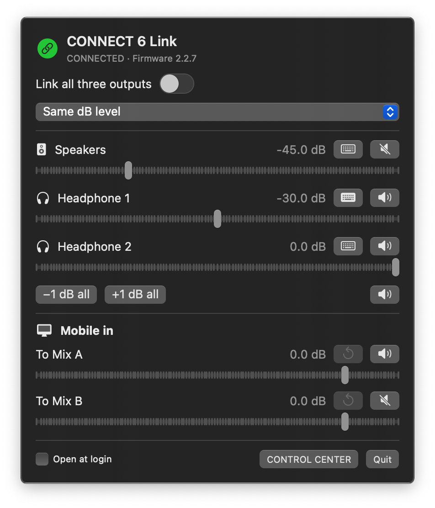

# CONNECT 6 Link

A native macOS menu bar utility for LEWITT CONNECT 6, with linked output volumes,
independent mute controls, Mobile input mixing, and system volume key assignment.

Independent community software. Not affiliated with or endorsed by LEWITT.



## Download and install

Download the universal DMG from [GitHub Releases](https://github.com/tim-crisp/lewitt-connect6-link/releases),
open it, and drag **CONNECT 6 Link.app** into **Applications**. Eject the DMG and
open the app from Applications. Look for its speaker/link icon in the menu bar;
it does not appear in the Dock.

- **macOS 13 Ventura or newer**, on Intel or Apple Silicon. One universal app
  contains both architectures.
- **One LEWITT CONNECT 6, firmware 2.2.7.** Discovery uses the model's USB vendor
  and product IDs, not a particular Mac, serial number, USB port, or username.
- Other firmware is refused until its undocumented protocol has been checked.
  Multiple connected CONNECT 6 units are not currently supported.
- CONTROL CENTER is optional for these controls. It is useful for firmware,
  presets, mic processing and routing. The app finds it by bundle ID wherever
  installed, rather than requiring a particular installation folder.

Each release states whether it is **Apple notarized**. Builds made without Apple
credentials are ad hoc signed and unnotarized: macOS may block their first launch.
For a download you trust, use **System Settings → Privacy & Security → Open Anyway**
after trying to open it. Managed Macs may disallow that exception. Do not disable
Gatekeeper globally. See [RELEASING.md](RELEASING.md) for signing/notarization.

## Controls

All controls fit in one compact panel without scrolling. Hover over an icon to
see its action; controls also have accessibility labels.

**Linked volumes.** Enable **Link all three outputs** to link Speakers,
Headphone 1 and Headphone 2. The hardware knob, CONTROL CENTER, app sliders, and
mapped Mac volume controls can lead the group. Updates are normally detected
within about 120 ms, plus firmware acknowledgement delay.

- **Keep level differences** moves all three by the same dB amount. Each output
  clamps independently at −60 and 0 dB, so differences can change at the limits.
- **Same dB level** makes all three follow the next output you change. Equal dB
  settings do not imply equal perceived loudness on different equipment.

Enabling linking or changing modes does not immediately change levels. Linking
starts **off** after launch or a disconnection; reconnection is automatic.
Quitting leaves the hardware at its current settings.

**Volume-key target.** Click the keyboard icon beside an output to assign the
Mac's volume rocker/keys to it. The active target shows a green filled keyboard.
This is the same setting as CONTROL CENTER's **Map native volume controls to**.
macOS must be using CONNECT 6 as its output device. With linking off, only the
selected output follows the keys; with linking on, the others follow too.
Activation preserves levels, mutes and routing.

**Mute.** Each speaker/headphone icon toggles just that output's mute, independently
of linked volumes. The group mute button and **−1 dB all / +1 dB all** affect all
three outputs. Muting preserves levels.

**Mobile in.** Incoming audio from the computer/phone on the Mobile USB port has
**To Mix A** and **To Mix B** sends. Each has a −60 to +10 dB slider, mute button,
and reset arrow for **0 dB (unity gain)**. Level changes/reset preserve mute state.
These sends are independent of output linking and group mute. If Mix B carries
a mic-only feed, keep **Mobile in → Mix B** muted to exclude PC playback.

**Open at login.** Enable this after installing in Applications. Linking still
starts off at login. Changes made in CONTROL CENTER are reflected in the app.
The app does not intercept keyboard events, record audio, add audio latency,
install drivers, send telemetry, or require Accessibility/Microphone access.

## Build from source

Requires Xcode Command Line Tools (or Xcode), Swift 5.9+, and a macOS SDK.
Only system frameworks/tools are needed; there are no third-party runtime
packages.

```sh
bash test.sh
bash build.sh
bash package-dmg.sh
bash Tools/verify-package.sh
```

The app is in `dist/CONNECT 6 Link.app`; the DMG is
`dist/CONNECT6Link-<version>-universal.dmg`, with an Applications shortcut and
installation instructions. The default build targets `arm64 x86_64` regardless
of the build Mac's architecture. For a faster development build:

```sh
ARCHS=arm64 bash build.sh       # or ARCHS=x86_64
```

DMG packaging requires a universal build. `BUILD_DIR` and `DIST_DIR` select
alternative output directories. Local builds use an ad hoc signature and
hardened runtime; set `SIGNING_IDENTITY` to a Developer ID Application identity
for a timestamped distribution signature.

## Validation and releases

`test.sh` runs 40 Swift checks plus C tests of the real USB merge/write code
through an in-memory USB transport. They cover linking, limits, feedback,
individual mutes, Mobile sends, volume-key assignment, delayed firmware
acknowledgement, conflicts and preservation of unrelated settings.

GitHub Actions tests, builds both architectures and verifies the DMG on Apple
Silicon and Intel runners. Pull requests and pushes target **master**. Tagging
`v<version>` runs those checks and publishes a DMG, SHA-256 checksums and signing
information as a GitHub release. Manual Release workflow runs produce artifacts
without publishing. See [RELEASING.md](RELEASING.md).

The universal diagnostic supports separate hardware checks:

```sh
./build/connect6-diagnose                        # read settings only
./build/connect6-diagnose --verify-write         # lower outputs 0.5 dB, restore
./build/connect6-diagnose --verify-link          # each output leads, restore
./build/connect6-diagnose --verify-controls      # output mute/Mobile checks
./build/connect6-diagnose --verify-volume-keys   # assign each target, restore
```

Hardware checks temporarily change settings; keep controls still while they
run. Already-muted outputs/sends stay muted during `--verify-controls`. Hardware
checks passed on firmware 2.2.7. CI has no audio hardware, so compilation/mock
tests cannot guarantee behavior on untested firmware.

## Protocol and limits

The app uses shared IOKit USB control requests. It does not seize/reset the
interface or change macOS's selected sound device. Its protocol subset was
identified from CONTROL CENTER 5.2.2 and verified against firmware 2.2.7.
[PROTOCOL.md](PROTOCOL.md) documents the fields used; no vendor code/binary is
included.

Firmware writes use 128-byte general/mixer blocks. The app reads fresh data,
checks for competing changes, and patches only the intended fields. Mic gains,
phantom power, output routing, Mac input 1/2 remapping and unrelated controls are
preserved. Changes between a read and write can still race because the protocol
has no atomic transaction. Avoid loading presets while dragging linked levels.

Firmware may return old data just after accepting a write. The app waits up to
120 ms for acknowledgement without resending. Unconfirmed writes stop linking.
The acknowledged target prevents feedback and preserves new leader movements
while followers settle. If several outputs move between polls, the largest
change leads; ties prefer Speakers, Headphone 1, then Headphone 2.

Linking synchronizes control values, not sample clocks. Mobile out, microphone
gain, other software inputs and hardware source selection are outside the app's
controls. See [LEWITT's guide](https://www.lewitt-audio.com/support/online-guides/connect6)
for routing and firmware maintenance.

## Contributing and license

See [CONTRIBUTING.md](CONTRIBUTING.md) and [RELEASING.md](RELEASING.md).
Released under the [MIT License](LICENSE). LEWITT and CONNECT 6 are trademarks of
their respective owners.
